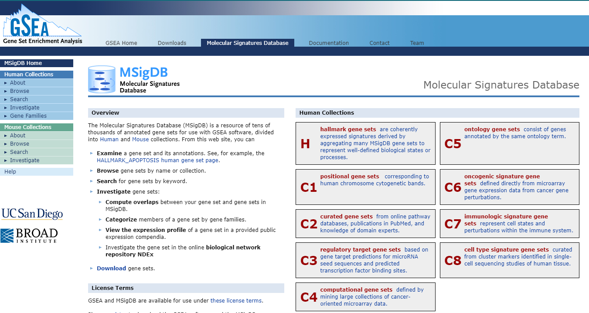

# **Signature Score Calculation**

The **`calculate_sig_score`** function integrates three gene set scoring methods: **ssGSEA**, **PCA**, and **z-score**.By inputting preprocessed transcriptomic data, the function can batch-calculate signature scores for each sample. This streamlined approach enables efficient and flexible scoring of gene signatures, supporting diverse research needs in transcriptomic data analysis.

## Loading packages
Load the IOBR package in your R session after the installation is complete:

``` r
library(IOBR)
library(survminer)
library(tidyverse)
```

## Downloading data for example
Obtaining data set from GEO [Gastric cancer: GSE62254](https://pubmed.ncbi.nlm.nih.gov/25894828/) using `GEOquery` R package.

``` r
if (!requireNamespace("GEOquery", quietly = TRUE)) BiocManager::install("GEOquery")
library("GEOquery")
# NOTE: This process may take a few minutes which depends on the internet connection speed. Please wait for its completion.
eset_geo <- getGEO(GEO = "GSE62254", getGPL = F, destdir = "./")
eset <- eset_geo[[1]]
eset <- exprs(eset)
eset[1:5, 1:5]
```

```
##           GSM1523727 GSM1523728 GSM1523729 GSM1523744 GSM1523745
## 1007_s_at  3.2176645  3.0624323  3.0279131   2.921683  2.8456013
## 1053_at    2.4050109  2.4394879  2.2442708   2.345916  2.4328582
## 117_at     1.4933412  1.8067380  1.5959665   1.839822  1.8326058
## 121_at     2.1965561  2.2812181  2.1865556   2.258599  2.1874363
## 1255_g_at  0.8698382  0.9502466  0.8125414   1.012860  0.9441993
```

Annotation of genes in the expression matrix and removal of duplicate genes.

``` r
# Load the annotation file `anno_hug133plus2` in IOBR.
anno_hug133plus2 <- load_data("anno_hug133plus2")
head(anno_hug133plus2)
```

```
## # A tibble: 6 × 2
##   probe_id  symbol 
##   <fct>     <fct>  
## 1 1007_s_at MIR4640
## 2 1053_at   RFC2   
## 3 117_at    HSPA6  
## 4 121_at    PAX8   
## 5 1255_g_at GUCA1A 
## 6 1294_at   MIR5193
```

``` r
# Conduct gene annotation using `anno_hug133plus2` file; If identical gene symbols exists, these genes would be ordered by the mean expression levels. The gene symbol with highest mean expression level is selected and remove others.

eset <- anno_eset(
  eset = eset,
  annotation = anno_hug133plus2,
  symbol = "symbol",
  probe = "probe_id",
  method = "mean"
)
eset[1:5, 1:3]
```

```
##              GSM1523727 GSM1523728 GSM1523729
## SH3KBP1        4.327974   4.316195   4.351425
## RPL41          4.246149   4.246808   4.257940
## EEF1A1         4.293762   4.291038   4.262199
## COX2           4.250288   4.283714   4.270508
## LOC101928826   4.219303   4.219670   4.213252
```


## Signature score estimation

### Signature collection of IOBR
**322 reported gene signatures** are collected in IOBR, including those related to the TME, metabolism, gene signatures derived from single-cell RNA-seq data, and others. The extensive signature collection is categorized into three distinct groups: **TME-associated**, **tumour-metabolism**, and **tumour-intrinsic signatures**.


``` r
# TME associated signatures
msig_immune <- load_data("msig_immune")
```

```
## ℹ Trying mirror 1/4: <https://github.com>
```

```
## ✔ Download complete: "msig_immune"
```

``` r
names(msig_immune)[1:20]
```

```
##  [1] "GOLDRATH_EFF_VS_MEMORY_CD8_TCELL_DN"                                       
##  [2] "GOLDRATH_EFF_VS_MEMORY_CD8_TCELL_UP"                                       
##  [3] "GOLDRATH_NAIVE_VS_EFF_CD8_TCELL_DN"                                        
##  [4] "GOLDRATH_NAIVE_VS_EFF_CD8_TCELL_UP"                                        
##  [5] "GOLDRATH_NAIVE_VS_MEMORY_CD8_TCELL_DN"                                     
##  [6] "GOLDRATH_NAIVE_VS_MEMORY_CD8_TCELL_UP"                                     
##  [7] "GSE10094_LCMV_VS_LISTERIA_IND_EFF_CD4_TCELL_DN"                            
##  [8] "GSE10094_LCMV_VS_LISTERIA_IND_EFF_CD4_TCELL_UP"                            
##  [9] "GSE10147_IL3_AND_HIVP17_VS_IL3_AND_CPG_STIM_PDC_DN"                        
## [10] "GSE10147_IL3_AND_HIVP17_VS_IL3_AND_CPG_STIM_PDC_UP"                        
## [11] "GSE10147_IL3_VS_IL3_AND_CPG_STIM_PDC_DN"                                   
## [12] "GSE10147_IL3_VS_IL3_AND_CPG_STIM_PDC_UP"                                   
## [13] "GSE10147_IL3_VS_IL3_AND_HIVP17_STIM_PDC_DN"                                
## [14] "GSE10147_IL3_VS_IL3_AND_HIVP17_STIM_PDC_UP"                                
## [15] "GSE10211_UV_INACT_SENDAI_VS_LIVE_SENDAI_VIRUS_TRACHEAL_EPITHELIAL_CELLS_DN"
## [16] "GSE10211_UV_INACT_SENDAI_VS_LIVE_SENDAI_VIRUS_TRACHEAL_EPITHELIAL_CELLS_UP"
## [17] "GSE10239_KLRG1INT_VS_KLRG1HIGH_EFF_CD8_TCELL_DN"                           
## [18] "GSE10239_KLRG1INT_VS_KLRG1HIGH_EFF_CD8_TCELL_UP"                           
## [19] "GSE10239_MEMORY_VS_DAY4.5_EFF_CD8_TCELL_DN"                                
## [20] "GSE10239_MEMORY_VS_DAY4.5_EFF_CD8_TCELL_UP"
```


``` r
# Metabolism related signatures
onco_sig <- load_data("onco_sig")
```

```
## ℹ Trying mirror 1/4: <https://github.com>
```

```
## ✔ Download complete: "onco_sig"
```

``` r
names(onco_sig)[1:20]
```

```
##  [1] "GLI1_UP.V1_DN"           "GLI1_UP.V1_UP"          
##  [3] "E2F1_UP.V1_DN"           "E2F1_UP.V1_UP"          
##  [5] "EGFR_UP.V1_DN"           "EGFR_UP.V1_UP"          
##  [7] "ERBB2_UP.V1_DN"          "ERBB2_UP.V1_UP"         
##  [9] "GCNP_SHH_UP_EARLY.V1_DN" "GCNP_SHH_UP_EARLY.V1_UP"
## [11] "GCNP_SHH_UP_LATE.V1_DN"  "GCNP_SHH_UP_LATE.V1_UP" 
## [13] "RAPA_EARLY_UP.V1_DN"     "RAPA_EARLY_UP.V1_UP"    
## [15] "HINATA_NFKB_IMMU_INF"    "HINATA_NFKB_MATRIX"     
## [17] "CYCLIN_D1_KE_.V1_DN"     "CYCLIN_D1_KE_.V1_UP"    
## [19] "CYCLIN_D1_UP.V1_DN"      "CYCLIN_D1_UP.V1_UP"
```

Signatures associated with basic biomedical research, such as m6A, TLS, ferroptosis and exosomes.

``` r
msig_sc <- load_data("msig_sc")
```

```
## ℹ Trying mirror 1/4: <https://github.com>
```

```
## ✔ Download complete: "msig_sc"
```

``` r
names(msig_sc)[1:20]
```

```
##  [1] "AIZARANI_LIVER_C1_NK_NKT_CELLS_1"              
##  [2] "AIZARANI_LIVER_C10_MVECS_1"                    
##  [3] "AIZARANI_LIVER_C11_HEPATOCYTES_1"              
##  [4] "AIZARANI_LIVER_C12_NK_NKT_CELLS_4"             
##  [5] "AIZARANI_LIVER_C13_LSECS_2"                    
##  [6] "AIZARANI_LIVER_C14_HEPATOCYTES_2"              
##  [7] "AIZARANI_LIVER_C17_HEPATOCYTES_3"              
##  [8] "AIZARANI_LIVER_C18_NK_NKT_CELLS_5"             
##  [9] "AIZARANI_LIVER_C2_KUPFFER_CELLS_1"             
## [10] "AIZARANI_LIVER_C20_LSECS_3"                    
## [11] "AIZARANI_LIVER_C21_STELLATE_CELLS_1"           
## [12] "AIZARANI_LIVER_C22_RESIDENT_B_CELLS_2"         
## [13] "AIZARANI_LIVER_C23_KUPFFER_CELLS_3"            
## [14] "AIZARANI_LIVER_C24_EPCAM_POS_BILE_DUCT_CELLS_3"
## [15] "AIZARANI_LIVER_C25_KUPFFER_CELLS_4"            
## [16] "AIZARANI_LIVER_C28_NK_NKT_CELLS_6"             
## [17] "AIZARANI_LIVER_C29_MVECS_2"                    
## [18] "AIZARANI_LIVER_C3_NK_NKT_CELLS_2"              
## [19] "AIZARANI_LIVER_C30_HEPATOCYTES_4"              
## [20] "AIZARANI_LIVER_C31_KUPFFER_CELLS_5"
```

`signature_collection` including all aforementioned signatures 

``` r
signature_collection <- load_data("signature_collection")
names(signature_collection)[1:20]
```

```
##  [1] "CD_8_T_effector"            "DDR"                       
##  [3] "APM"                        "Immune_Checkpoint"         
##  [5] "CellCycle_Reg"              "Pan_F_TBRs"                
##  [7] "Histones"                   "EMT1"                      
##  [9] "EMT2"                       "EMT3"                      
## [11] "WNT_target"                 "FGFR3_related"             
## [13] "Cell_cycle"                 "Mismatch_Repair"           
## [15] "Homologous_recombination"   "Nucleotide_excision_repair"
## [17] "DNA_replication"            "Base_excision_repair"      
## [19] "TMEscoreA_CIR"              "TMEscoreB_CIR"
```

The evaluation of signature scores involved three methodologies: Single-sample Gene Set Enrichment Analysis (ssGSEA), Principal Component Analysis (PCA), and Z-score.

## Estimation of signature using PCA method
The PCA method is ideal for gene sets with co-expression. Heatmaps and correlation matrices can be used to determine if co-expression is present in the applicable gene set.

``` r
sig_tme <- calculate_sig_score(
  pdata = NULL,
  eset = eset,
  signature = signature_collection,
  method = "pca",
  mini_gene_count = 2
)

sig_tme <- t(column_to_rownames(sig_tme, var = "ID"))
sig_tme[1:5, 1:3]
```

```
##                   GSM1523727 GSM1523728 GSM1523729
## CD_8_T_effector   -2.5513794  0.7789141 -2.1770675
## DDR               -0.8747614  0.7425162 -1.3272054
## APM                1.1098368  2.1988688 -0.9516419
## Immune_Checkpoint -2.3701787  0.9455120 -1.4844104
## CellCycle_Reg      0.1063358  0.7583302 -0.3649795
```

## Estimated using the ssGSEA methodology

This method is appropriate for gene sets that contain a large number of genes (> 30 genes), such as those of [GO, KEGG, REACTOME gene sets](https://www.gsea-msigdb.org/gsea/msigdb).

<div class="figure" style="text-align: center">

<p class="caption">(\#fig:unnamed-chunk-9)Gene sets of MSigDb</p>
</div>


``` r
sig_tme <- calculate_sig_score(
  pdata = NULL,
  eset = eset,
  signature = load_data("go_bp"),
  method = "ssgsea",
  mini_gene_count = 2
)
```

## Calculated using the z-score function.


``` r
sig_tme <- calculate_sig_score(
  pdata = NULL,
  eset = eset,
  signature = load_data("signature_collection"),
  method = "zscore",
  mini_gene_count = 2
)
```

## Calculated using all three methods at the same time


``` r
sig_tme <- calculate_sig_score(
  pdata = NULL,
  eset = eset,
  signature = load_data("signature_collection"),
  method = "integration",
  mini_gene_count = 2
)
```

The same signature in this case will be scored using all three methods simultaneously.


``` r
colnames(sig_tme)[grep(colnames(sig_tme), pattern = "CD_8_T_effector")]
```

```
## [1] "CD_8_T_effector_PCA"    "CD_8_T_effector_zscore" "CD_8_T_effector_ssGSEA"
```

The `select_method()` function allows the user to extract data using various methods.


``` r
sig_tme_pca <- select_method(data = sig_tme, method = "PCA")
colnames(sig_tme_pca)[grep(colnames(sig_tme_pca), pattern = "CD_8_T_effector")]
```

```
## [1] "CD_8_T_effector"
```

## Classification of signatures

As more signatures related to the tumour microenvironment were collected in IOBR, and we may continue to add gene signatures related to the tumour microenvironment in the future, we have made a basic classification of these signatures by combining them with our analysis experience. Users can compare the signatures in the same group during the analysis process to improve the reliability and consistency of the conclusions.


``` r
load_data("sig_group")[1:8]
```

```
## $tumor_signature
##  [1] "CellCycle_Reg"                            
##  [2] "Cell_cycle"                               
##  [3] "DDR"                                      
##  [4] "Mismatch_Repair"                          
##  [5] "Histones"                                 
##  [6] "Homologous_recombination"                 
##  [7] "Nature_metabolism_Hypoxia"                
##  [8] "Molecular_Cancer_m6A"                     
##  [9] "MT_exosome"                               
## [10] "Positive_regulation_of_exosomal_secretion"
## [11] "Ferroptosis"                              
## [12] "EV_Cell_2020"                             
## 
## $EMT
## [1] "Pan_F_TBRs" "EMT1"       "EMT2"       "EMT3"       "WNT_target"
## 
## $io_biomarkers
##  [1] "TMEscore_CIR"                    "TMEscoreA_CIR"                  
##  [3] "TMEscoreB_CIR"                   "T_cell_inflamed_GEP_Ayers_et_al"
##  [5] "CD_8_T_effector"                 "IPS_IPS"                        
##  [7] "Immune_Checkpoint"               "Exhausted_CD8_Danaher_et_al"    
##  [9] "Pan_F_TBRs"                      "Mismatch_Repair"                
## [11] "APM"                            
## 
## $immu_microenvironment
##  [1] "GPAGs"                       "PPAGs"                      
##  [3] "Pan_F_TBRs"                  "MDSC_Peng_et_al"            
##  [5] "TAM_Peng_et_al"              "MicroenvironmentScore_xCell"
##  [7] "TMEscore"                    "ImmuneScore_xCell"          
##  [9] "ImmuneScore_estimate"        "StromalScore_estimate"      
## 
## $immu_suppression
## [1] "Pan_F_TBRs"                          
## [2] "Fibroblasts_MCPcounter"              
## [3] "Immune_Checkpoint"                   
## [4] "Exhausted_CD8_Danaher_et_al"         
## [5] "MDSC_Wang_et_al"                     
## [6] "Macrophages_M2_cibersort"            
## [7] "Tregs_quantiseq"                     
## [8] "T_cells_regulatory_(Tregs)_CIBERSORT"
## 
## $immu_exclusion
##  [1] "Pan_F_TBRs"                          
##  [2] "CAF_Peng_et_al"                      
##  [3] "Fibroblasts_MCPcounter"              
##  [4] "CAFs_EPIC"                           
##  [5] "EMT1"                                
##  [6] "EMT2"                                
##  [7] "WNT_target"                          
##  [8] "TGFb_Family_Member_Receptor_Li_et_al"
##  [9] "TGFb_Family_Member_Li_et_al"         
## [10] "Macrophages_M2_CIBERSORT"            
## [11] "Macrophages_M2_quantiseq"            
## [12] "TAM_Peng_et_al"                      
## 
## $immu_exhaustion
## [1] "Immune_Checkpoint"                   
## [2] "Exhausted_CD8_Danaher_et_al"         
## [3] "T_cell_exhaustion_Peng_et_al"        
## [4] "T_cells_regulatory_(Tregs)_CIBERSORT"
## [5] "T_cell_regulatory_Peng_et_al"        
## [6] "ICB_resistance_Peng_et_al"           
## [7] "StromalScore_estimate"               
## 
## $TCR_BCR
## [1] "TCR_signaling_Pathway_Li_et_al"    "REACTOME_DOWNSTREAM_TCR_SIGNALING"
## [3] "REACTOME_TCR_SIGNALING"            "BCR_Signaling_Pathway_Li_et_al"   
## [5] "APM"
```

## How to customise the signature gene list for `calculate_signature_score`

To overcome the limitations of fixed signatures in IOBR, users are now allowed to create customized gene signature lists for the **`calculate_sig_score`** function, enabling more flexible transcriptomic data analysis tailored to specific research goals.

### Method-1: Use excel for storage and construction

Users can collect gene signatures using either an `Excel` or `CSV` file. The format should have the name of the signature in the first row, followed by the genes contained in each signature from the second row onwards. Once imported, the function `format_signature` can be used to transform the data into a gene list of signatures required for `calculate_signature_score`. To import the file into R, users can use the functions read.csv or read_excel. It is important to note here that the user needs to use the longest signature as a criterion and then replace all the vacant grids using NA, otherwise an error may be reported when reading into R.

Here we provide a sample data `sig_excel`, please refer to this format to construct the required csv or excel files.

``` r
sig_excel <- load_data("sig_excel")
sig <- format_signatures(sig_excel)
print(sig[1:5])
```

```
## $Tcell_co_inhibitors
##  [1] "ADORA2A"  "BTLA"     "BTN2A2"   "BTN3A1"   "BTN3A2"   "BTNL2"   
##  [7] "C10orf54" "CSF1R"    "HAVCR2"   "IDO1"     "IL10"     "IL10RB"  
## [13] "KDR"      "KIR2DL1"  "SLAMF7"   "TGFB1"    "TIGIT"    "VRCN1"   
## [19] "VTCN1"    "CD247"    "CTLA4"    "CD160"    "CD244"    "CD274"   
## [25] "CD276"    "CD48"     "CD96"     "KIR2DL2"  "KIR2DL3"  "LAG3"    
## [31] "LAIR1"    "LGALS9"   "PVRL2"    "PDCD1"    "PDCD1LG2"
## 
## $Tcell_co_stimuiations
##  [1] "BTNL8"     "CD226"     "CD27"      "CD28"      "CD40"      "CD58"     
##  [7] "CD70"      "SLAMF1"    "TMIGD2"    "TNFRSF13B" "TNFRSF13C" "TNFRSF14" 
## [13] "TNFRSF4"   "TNFRSF8"   "TNFSF8"    "TNFSF9"    "ENTPD1"    "NT5E"     
## [19] "ICOS"      "TNFSF4"    "TNFSF15"   "CD80"      "CD86"      "EGFR"     
## [25] "HAVCR1"    "TNFSF18"   "ICOSLG"    "TNFSF13B"  "TNFRSF9"   "TNFSF13"  
## 
## $Tcell_function
## [1] "CD3E"  "CD4"   "CD8B"  "FOXP3" "GZMB"  "PRF1"  "TBX21" "IL2RA" "IKZF2"
## 
## $Tcell_checkpoint
##  [1] "CD274"    "CTLA4"    "LAG3"     "TIM3"     "TNFRSF9"  "TIGIT"   
##  [7] "CD226"    "CD7"      "GZMB"     "PRF1"     "TNFRSF18" "TNFRSF4" 
## [13] "HAVCR2"   "NLG1"     "CD4"      "CD8A"     "CD8B"     "FOXP3"   
## [19] "IL2"      "CXCL8"    "PDCD1"    "IFNG"    
## 
## $Teffctore_score
## [1] "CD8A"   "CXCL10" "CXCL9"  "GZMA"   "GZMB"   "IFNG"   "PRF1"   "TBX21"
```
For simple structures or when the number of signatures to be added is relatively small, the following two methods can also be used.

### Method-2: Build the list structure directly


``` r
sig <- list(
  "CD8" = c("CD8A", "CXCL10", "CXCL9", "GZMA", "GZMB", "IFNG", "PRF1", "TBX21"),
  "ICB" = c("CD274", "PDCD1LG2", "CTLA4", "PDCD1", "LAG3", "HAVCR2", "TIGIT")
)
sig
```

```
## $CD8
## [1] "CD8A"   "CXCL10" "CXCL9"  "GZMA"   "GZMB"   "IFNG"   "PRF1"   "TBX21" 
## 
## $ICB
## [1] "CD274"    "PDCD1LG2" "CTLA4"    "PDCD1"    "LAG3"     "HAVCR2"   "TIGIT"
```

### Method-3: Add the new signature to the existing gene list


``` r
msig_sc <- load_data("msig_sc")
```

```
## ℹ Loading cached data: "msig_sc"
```

``` r
sig <- msig_sc
sig$CD8 <- c("CD8A", "CXCL10", "CXCL9", "GZMA", "GZMB", "IFNG", "PRF1", "TBX21")
tail(sig, 1)
```

```
## $CD8
## [1] "CD8A"   "CXCL10" "CXCL9"  "GZMA"   "GZMB"   "IFNG"   "PRF1"   "TBX21"
```

### Method-4: Construct cell-specific gene signatures from single-cell differential analysis results


``` r
deg <- load_data("deg")
sig <- get_sig_sc(deg, cluster = "cluster", gene = "gene", avg_log2FC = "avg_log2FC", n = 100)
sig
```

```
## $`Epithelial cells 11`
##   [1] "AQP4"        "BCAT1"       "RGS16"       "LRRN4"       "TIMP3"      
##   [6] "SUSD2"       "AQP1"        "CYP4B1"      "AGER"        "FAM46B"     
##  [11] "SCGB3A1"     "PEG10"       "AK1"         "DLX3"        "GSTM3"      
##  [16] "BTG2"        "GDF15"       "CTSE"        "CLDN18"      "EFNA1"      
##  [21] "DEGS2"       "CYR61"       "CKB"         "KLHL35"      "ARL4D"      
##  [26] "C4BPA"       "SRRM2"       "HMGN2"       "SFTPB"       "RNASE1"     
##  [31] "EGR1"        "C16orf89"    "IFIT1"       "FBLN5"       "SFTA2"      
##  [36] "IRX5"        "GGH"         "FABP3"       "SULT1A2"     "SLC34A2"    
##  [41] "CDKN2A"      "HMGN3"       "RSRP1"       "C12orf65"    "SFTPD"      
##  [46] "ARHGAP24"    "TMEM37"      "NAPSA"       "IGFBP2"      "TUBA4A"     
##  [51] "CA2"         "PIFO"        "MLF1"        "THUMPD3-AS1" "CLU"        
##  [56] "TRA2A"       "IFI27"       "ATHL1"       "ARHGEF2"     "CYP51A1"    
##  [61] "STMN1"       "PGC"         "SFPQ"        "CDKN1C"      "ACBD3"      
##  [66] "DGKD"        "C19orf53"    "FAM177A1"    "HIST1H2AM"   "SCGB3A2"    
##  [71] "ZNF593"      "ARHGEF17"    "ATP13A4-AS1" "ISG15"       "MMP15"      
##  [76] "GADD45GIP1"  "PEBP4"       "ZFAND2A"     "PARP1"       "TPPP3"      
##  [81] "GADD45G"     "CD55"        "SERTAD1"     "RDH10"       "OSR2"       
##  [86] "CLIC3"       "TPPP"        "SNRNP25"     "C4BPB"       "RANBP10"    
##  [91] "TNNC1"       "CRYM"        "PHLDA2"      "TFAP2C"      "EPHX1"      
##  [96] "SFN"         "MRPL2"       "ZNF493"      "SNX22"       "ALKBH4"     
## 
## $`Epithelial cells 15`
##   [1] "SFTPC"       "SFTPA1"      "SFTPA2"      "FABP5"       "SFTPD"      
##   [6] "SFTPB"       "PEBP4"       "ABCA3"       "CSF3R"       "NAPSA"      
##  [11] "PGC"         "WIF1"        "MACROD2"     "CLDN18"      "SLPI"       
##  [16] "HP"          "DUOX1"       "C16orf89"    "AQP1"        "AK1"        
##  [21] "SCGB3A1"     "CA2"         "SCGB3A2"     "SCD"         "AFF3"       
##  [26] "NECAB1"      "FGG"         "SLC34A2"     "MFSD2A"      "GADD45G"    
##  [31] "SFTA2"       "PTPN13"      "RASGRF1"     "AQP4"        "C1R"        
##  [36] "ACOXL"       "NR0B2"       "PLA2G4F"     "DCXR"        "SUSD2"      
##  [41] "ADIRF"       "FILIP1"      "RGS16"       "MYLK"        "HLA-DQB2"   
##  [46] "ORM1"        "ETV5"        "TSPAN7"      "CXCL17"      "PHYHD1"     
##  [51] "RNASE1"      "TTN"         "SNX30"       "C4BPA"       "CHI3L1"     
##  [56] "IFITM1"      "FAM46C"      "SFTA1P"      "CHI3L2"      "GUCY1A3"    
##  [61] "CLIC3"       "GOLIM4"      "EGR1"        "TPPP3"       "SULT1A2"    
##  [66] "CYP4B1"      "ATP13A4-AS1" "KCNJ2"       "SLC5A2"      "TMEM37"     
##  [71] "PLLP"        "PTTG1"       "ARL4D"       "PLIN5"       "HMGN2"      
##  [76] "PMM1"        "RSRP1"       "CLU"         "PIGR"        "QDPR"       
##  [81] "AGER"        "DMBT1"       "PEG10"       "RSBN1"       "CKB"        
##  [86] "RMDN2"       "CYR61"       "NUDT14"      "F3"          "CTSE"       
##  [91] "C3"          "TUBA4A"      "IRX5"        "C12orf65"    "CCND3"      
##  [96] "TMEM116"     "TUBA1B"      "PLEKHB1"     "IVD"         "ACP5"       
## 
## $`Epithelial cells 2`
##   [1] "IGFBP3"   "PCDH7"    "PTPRN2"   "ADAM28"   "CASP1"    "TRAF2"   
##   [7] "CYBA"     "SERPINE1" "IL32"     "RFK"      "TRIM16"   "FXYD5"   
##  [13] "RAMP1"    "EGFL7"    "SNAP23"   "ATP6V1E1" "HSD11B2"  "BATF"    
##  [19] "UACA"     "TCTN3"    "HSPA9"    "BIK"      "ACSL1"    "POLR3K"  
##  [25] "CCL28"    "AUH"      "CMC4"     "PRPS1"    "EFHD2"    "RAB24"   
##  [31] "RER1"     "HN1"      "MTCH2"    "NTMT1"    "COMTD1"   "KRT16"   
##  [37] "STX7"     "PDCD6IP"  "UBTD2"    "CHMP1B"   "DSC2"     "UBA7"    
##  [43] "VTA1"     "P4HA1"    "UFM1"     "PTP4A1"   "CEBPG"    "AMZ2"    
##  [49] "PLIN2"    "PRPS2"    "RNASEH1"  "KATNBL1"  "PSMD5"    "MECR"    
##  [55] "DCUN1D1"  "PEX19"    "TIMM17A"  "SGMS1"    "C7orf73"  "ORC5"    
##  [61] "UBQLN1"   "VAPA"     "PAFAH1B3" "PEX11B"   "DRG1"     "ADSL"    
##  [67] "UBN1"     "CLNS1A"   "SUMF1"    "NSMCE1"   "COG7"     "DGAT1"   
##  [73] "NDUFS3"   "YIPF5"    "CCDC78"   "RAB6A"    "LPP"      "CHMP2B"  
##  [79] "G3BP1"    "AAAS"     "MOV10"    "C3"       "CRIP1"    "LSG1"    
##  [85] "RSPH3"    "SNRPA1"   "DNAJA3"   "HIGD1A"   "ARHGDIB"  "PIGG"    
##  [91] "CCT4"     "TES"      "CCNJL"    "LEPROT"   "ATP6V1D"  "AFMID"   
##  [97] "TALDO1"   "NGRN"     "PSG5"     "CD55"    
## 
## $`Epithelial cells 23`
##   [1] "NECAB1"      "SFTPC"       "SFTPA1"      "PGC"         "SFTPA2"     
##   [6] "CA2"         "PEBP4"       "ABCA3"       "ETV5"        "HNRNPH1"    
##  [11] "CHI3L2"      "SAR1A"       "MFSD2A"      "C4BPA"       "C1R"        
##  [16] "LTF"         "F3"          "CXCL2"       "NR0B2"       "PIGR"       
##  [21] "FABP5"       "SFTPD"       "NAPSA"       "EGR1"        "PTPN13"     
##  [26] "SFTPB"       "CLU"         "RRAD"        "WIF1"        "DUOX1"      
##  [31] "AQP1"        "NFKBIZ"      "TOB1"        "SLC34A2"     "TRA2A"      
##  [36] "RASGRF1"     "UGCG"        "HACD1"       "PHYHD1"      "AFF3"       
##  [41] "CHI3L1"      "GOLIM4"      "CD274"       "KCNJ2"       "SLC38A2"    
##  [46] "PPP3CA"      "C16orf89"    "ACOXL"       "SCD"         "SKIL"       
##  [51] "RDH10"       "WTAP"        "TSC22D2"     "SCGB3A1"     "ARGLU1"     
##  [56] "DMBT1"       "AZGP1"       "C8orf4"      "NNMT"        "RNASE1"     
##  [61] "PLA2G4F"     "NUCKS1"      "FGG"         "LRRC75A-AS1" "UBE2B"      
##  [66] "SERTAD1"     "HMGCS1"      "MBNL1"       "PLIN5"       "ADAM17"     
##  [71] "DDX3X"       "CTNNB1"      "FAM46B"      "PPP1CB"      "CLDN18"     
##  [76] "ATP13A4-AS1" "SNX30"       "CYP51A1"     "PTP4A1"      "SUSD2"      
##  [81] "TFAP2C"      "HP"          "STOM"        "STAM"        "RAB21"      
##  [86] "MPZL3"       "CRIM1"       "MACROD2"     "STK17A"      "UGDH"       
##  [91] "KCTD9"       "ALDH6A1"     "FNIP1"       "ZC3H4"       "DUSP14"     
##  [96] "CXCL17"      "DCBLD2"      "PPP6R3"      "ARL8B"       "SLMO2"      
## 
## $`Epithelial cells 25`
##   [1] "LYPD2"       "REG1A"       "SERPINB3"    "SERPINB5"    "CLDN10"     
##   [6] "ARL14"       "SERPINB4"    "MUC5AC"      "AKR1C2"      "KRT17"      
##  [11] "IL1RN"       "ALDH3A1"     "C12orf75"    "SERPINA3"    "KRT6A"      
##  [16] "BASP1"       "BPIFB1"      "PRKCDBP"     "CDKN2A"      "HNRNPH1"    
##  [21] "SFN"         "MUC5B"       "CXCL1"       "RARRES1"     "F3"         
##  [26] "IFITM1"      "NUCKS1"      "MLF1"        "ST6GAL1"     "EREG"       
##  [31] "OXCT1"       "MAFIP"       "IFI27"       "KLK11"       "PHLDA2"     
##  [36] "TIMP1"       "TOB1"        "LRRC75A-AS1" "S100A2"      "EEF1B2"     
##  [41] "PADI2"       "AEN"         "BCL10"       "EGR1"        "HMGCS1"     
##  [46] "WTAP"        "TRA2A"       "HACD1"       "BTG2"        "AKR1C1"     
##  [51] "SKIL"        "OLFM1"       "MPRIP"       "SNRPB"       "WEE1"       
##  [56] "JAG1"        "SLC7A5P2"    "ATHL1"       "EFHD2"       "GMDS"       
##  [61] "C12orf57"    "IL17RB"      "GGH"         "UGCG"        "MIR205HG"   
##  [66] "STAT2"       "SERTAD1"     "R3HDM2"      "CTNNB1"      "NCOR1"      
##  [71] "ARGLU1"      "PDCD4"       "CLTB"        "GMNN"        "RIN2"       
##  [76] "PPP3CA"      "UBE2B"       "SLC5A2"      "PPP1CB"      "STON2"      
##  [81] "DST"         "KIAA1217"    "ARFIP2"      "FAM208B"     "RASSF6"     
##  [86] "HIST1H2AM"   "SMURF2"      "FKBP9"       "ARL8B"       "RREB1"      
##  [91] "UGDH"        "HIST1H4C"    "HMGN3"       "BIK"         "B3GALNT2"   
##  [96] "C4BPB"       "TRIM16"      "PDGFA"       "ZC3H4"       "HMGCR"      
## 
## $`Epithelial cells 26`
##   [1] "ITLN2"    "FMO2"     "RTKN2"    "AGER"     "HEG1"     "CRYAB"   
##   [7] "IGFBP7"   "CLDN18"   "SPOCK2"   "UPK3B"    "CYP4B1"   "TNNC1"   
##  [13] "PDPN"     "ADIRF"    "SFTA1P"   "TIMP3"    "KLK11"    "COL4A2"  
##  [19] "AQP4"     "ABCA1"    "PLLP"     "CLIC3"    "RGCC"     "CCND2"   
##  [25] "TAGLN"    "SUSD2"    "SBSPON"   "RNASE1"   "WFS1"     "MGLL"    
##  [31] "MAP2"     "SULT1A2"  "TUBA1A"   "UNC13D"   "IFI27"    "CD55"    
##  [37] "FKBP1B"   "AKR1C1"   "RIN2"     "F3"       "FILIP1"   "FN1"     
##  [43] "PEBP4"    "FAM46B"   "SFTA2"    "PRKCDBP"  "CRIP1"    "TMEM98"  
##  [49] "CEACAM6"  "CKB"      "FBLN5"    "PHACTR2"  "EPB41L5"  "DST"     
##  [55] "ARHGAP24" "PEG10"    "ABI3BP"   "LRRN4"    "TSPAN7"   "CTGF"    
##  [61] "FBXL15"   "STOM"     "HMGN2"    "SDC1"     "STON2"    "QKI"     
##  [67] "RFC1"     "PDGFA"    "FAS"      "IFT43"    "TXNRD2"   "DUOX1"   
##  [73] "ARL8B"    "NHLRC3"   "TERF1"    "SNX22"    "CYR61"    "RBM17"   
##  [79] "TJP1"     "SAP30BP"  "SGMS1"    "ARAP2"    "HSD17B8"  "MICA"    
##  [85] "STX7"     "TRIM5"    "VPS4B"    "PDS5B"    "NUCKS1"   "PCMTD1"  
##  [91] "SFTPB"    "MDM4"     "FAM134A"  "ACAA2"    "CTSE"     "ABCA7"   
##  [97] "SNRPB"    "CIAPIN1"  "HNRNPA0"  "PHF10"   
## 
## $`Epithelial cells 27`
##   [1] "APOBEC3H"         "ALDH3A1"          "LDHD"            
##   [4] "AZGP1"            "SCGB3A2"          "MT1G"            
##   [7] "KLK11"            "TPPP3"            "TMEM37"          
##  [10] "RASL11A"          "CTSE"             "CEACAM5"         
##  [13] "DEGS2"            "ITPR2"            "NHS"             
##  [16] "LL22NC03-75H12.2" "TMEM98"           "C16orf89"        
##  [19] "C4BPA"            "HLA-DQB2"         "SLC1A7"          
##  [22] "GSTA1"            "AKR7A2"           "BTG2"            
##  [25] "CXCL17"           "RARRES2"          "IGFBP2"          
##  [28] "TMEM230"          "SUSD2"            "CYP4B1"          
##  [31] "PPIE"             "SYT2"             "LINC00578"       
##  [34] "TERF2IP"          "SRRM2"            "SFTA2"           
##  [37] "PMM1"             "DHRS4-AS1"        "GDF15"           
##  [40] "SFTPB"            "NME3"             "CXCL14"          
##  [43] "PLLP"             "CLU"              "ELOVL1"          
##  [46] "SFTPD"            "PEMT"             "MLF1"            
##  [49] "IFI27"            "MRPL57"           "NGDN"            
##  [52] "SNRPB"            "SNRNP25"          "MTSS1L"          
##  [55] "UBE2I"            "MAFIP"            "AQP4"            
##  [58] "SCGB3A1"          "CHMP4A"           "PIGR"            
##  [61] "ITPA"             "IRX5"             "CEACAM6"         
##  [64] "SZT2"             "TMEM205"          "RGS16"           
##  [67] "DNAJA3"           "NAPSA"            "TMEM52"          
##  [70] "POLR3K"           "GFRA3"            "MSRB1"           
##  [73] "CCDC101"          "IVD"              "PCNA"            
##  [76] "NUDT16L1"         "HLA-DOB"          "BCL6"            
##  [79] "FTO"              "SFTA1P"           "C10orf32"        
##  [82] "MLYCD"            "AK1"              "CCDC115"         
##  [85] "DMBT1"            "RNASE1"           "CIAPIN1"         
##  [88] "FAM71E1"          "COQ9"             "CPAMD8"          
##  [91] "ALDH6A1"          "MMP15"            "PLEKHB1"         
##  [94] "RMDN2"            "LYRM1"            "HSD17B8"         
##  [97] "YRDC"             "ERAL1"            "SLC5A2"          
## [100] "MMP7"            
## 
## $`Epithelial cells 28`
##   [1] "UPK1B"      "BPIFB1"     "KLK6"       "PSG3"       "PPBP"      
##   [6] "LDLRAD1"    "PADI2"      "MSMB"       "ADGRE2"     "PSG5"      
##  [11] "IGFBP3"     "SLC30A2"    "APOD"       "TALDO1"     "KRT6A"     
##  [16] "KRT16"      "TMEM140"    "IL3RA"      "KRT4"       "CHMP1B"    
##  [21] "ZNF793-AS1" "TRIM16"     "P4HA1"      "APOL2"      "WFS1"      
##  [26] "KRT17"      "MARCKS"     "KRT13"      "MOV10"      "HDAC9"     
##  [31] "CLN5"       "RNF13"      "CLP1"       "DAZAP2"     "WEE1"      
##  [36] "BIK"        "UACA"       "RNF114"     "DYNLL1"     "S100A9"    
##  [41] "NDRG3"      "TMEM106C"   "QRICH1"     "SUMF1"      "CSTF1"     
##  [46] "PPAP2B"     "P4HTM"      "LOC283788"  "CHID1"      "UBE2D1"    
##  [51] "ARFIP2"     "RARRES1"    "UNG"        "TBC1D1"     "SERPINE1"  
##  [56] "PEX11B"     "TMTC3"      "TOMM34"     "NARS"       "STOM"      
##  [61] "UBQLN1"     "PIGG"       "COMMD7"     "RFK"        "BLOC1S4"   
##  [66] "ADAM10"     "TFAP2C"     "CTNNB1"     "FUBP1"      "HAT1"      
##  [71] "CRIP1"      "C3"         "HNRNPC"     "VTA1"       "CCT4"      
##  [76] "PDCD6IP"    "LSG1"       "SNAP23"     "HIGD1A"     "PAFAH1B3"  
##  [81] "AAAS"       "PIP4K2C"    "CLIC3"      "RER1"       "UBA7"      
##  [86] "RSPH3"      "UFM1"       "AUH"        "CEACAM5"    "VPS41"     
##  [91] "TCTN3"      "TJP1"       "IFIT2"      "CCL28"      "CHMP2B"    
##  [96] "COG7"       "ACTR10"     "FXYD5"      "PTP4A1"     "HSPA9"     
## 
## $`Epithelial cells 29`
##   [1] "PRSS2"      "PRSS1"      "PRSS3"      "ATG9B"      "PLA1A"     
##   [6] "PAEP"       "AZGP1"      "UBE2C"      "TNFRSF18"   "G0S2"      
##  [11] "CDA"        "ALDOC"      "NME1-NME2"  "MIR205HG"   "CDKN2A"    
##  [16] "AKR1B1"     "CHI3L1"     "C4orf48"    "YEATS4"     "MAP1B"     
##  [21] "TNNC2"      "RGS17"      "PPAT"       "MSRB1"      "ZNF593"    
##  [26] "LAGE3"      "RAN"        "ICT1"       "NOP16"      "RASSF3"    
##  [31] "EEF1B2"     "SLC27A5"    "MYEOV2"     "GEMIN6"     "TIMP1"     
##  [36] "CEACAM5"    "CD320"      "HN1"        "MRPL13"     "APOD"      
##  [41] "S100A2"     "MRPL32"     "MRPL21"     "PAFAH1B3"   "GDF15"     
##  [46] "GADD45GIP1" "PHLDA2"     "QTRTD1"     "ANGPTL4"    "C19orf24"  
##  [51] "POLE4"      "SUPT4H1"    "MTIF2"      "MRPL57"     "DDX18"     
##  [56] "ACOX2"      "SDC1"       "CCDC59"     "DST"        "ATP5D"     
##  [61] "SNHG17"     "SLC34A2"    "DCBLD2"     "SNRNP25"    "NIFK"      
##  [66] "MPHOSPH10"  "NAA10"      "TBCB"       "S100A9"     "PLIN2"     
##  [71] "MRPL40"     "ITPA"       "TFAM"       "TMEM61"     "TMEM98"    
##  [76] "GPATCH4"    "TRMT10C"    "SLMO2"      "RPS19BP1"   "RPP21"     
##  [81] "NUFIP2"     "NAPSA"      "RAMP1"      "MEA1"       "NSMCE1"    
##  [86] "CEBPZOS"    "APOL2"      "TMEM14A"    "COMTD1"     "PSMD9"     
##  [91] "DTYMK"      "SNHG11"     "HINT2"      "NT5C"       "TMEM91"    
##  [96] "SFTA2"      "AP1AR"      "POLR3K"     "GOLT1A"     "SMIM6"     
## 
## $`Epithelial cells 6`
##   [1] "PTN"        "CHGB"       "NR2F1-AS1"  "CRLF1"      "PGF"       
##   [6] "MUC5B"      "MGP"        "COL1A1"     "CCDC80"     "KRT81"     
##  [11] "MIR205HG"   "CEACAM6"    "IFITM1"     "NHS"        "EREG"      
##  [16] "RGS17"      "CDKN2A"     "CCL2"       "CAMK1D"     "S100A9"    
##  [21] "IFI27"      "PHGDH"      "SNHG18"     "DMBT1"      "CEMIP"     
##  [26] "NNMT"       "ARL4A"      "CXCL14"     "OXCT1"      "CEACAM5"   
##  [31] "TNFRSF18"   "TGM2"       "THBS1"      "CYSLTR1"    "COL17A1"   
##  [36] "HDGFRP3"    "LOC648987"  "EMB"        "TNFSF10"    "SPON2"     
##  [41] "ARHGDIB"    "PIGR"       "NR1D1"      "CLEC2D"     "RN7SK"     
##  [46] "RNASE1"     "TIMP1"      "SLC38A1"    "CXCL1"      "CDKN1C"    
##  [51] "ATHL1"      "TGFBI"      "MARCKS"     "SLC12A2"    "GUCY1A3"   
##  [56] "PHLDA2"     "TRA2A"      "EXOC3-AS1"  "LRRC37A4P"  "C4orf48"   
##  [61] "C21orf2"    "WEE1"       "PIP4K2C"    "CD320"      "C12orf57"  
##  [66] "IGFBP2"     "C8orf4"     "TMEM205"    "XRRA1"      "IRF2BPL"   
##  [71] "STON2"      "RRAD"       "SNHG1"      "EPHX1"      "ISG15"     
##  [76] "TMEM238"    "MRPL39"     "IRF7"       "CHI3L1"     "NFKBIZ"    
##  [81] "CCDC85B"    "YBEY"       "LINC00649"  "C4BPB"      "ZNF195"    
##  [86] "KRT17"      "ATP5D"      "PDK3"       "CAPS"       "PMAIP1"    
##  [91] "IVD"        "DST"        "HSPA6"      "SAC3D1"     "UBE2S"     
##  [96] "ABCA7"      "SEPT11"     "C19orf60"   "HPGD"       "GADD45GIP1"
```

## How to export gene signature

Using the `output_sig` function, user can export the signatures of the list structure to a csv file for other purposes. This step is exactly the reverse of `format_signatures`.


``` r
msig_sc <- load_data("msig_sc")
```

```
## ℹ Loading cached data: "msig_sc"
```

``` r
sig <- output_sig(signatures = msig_sc, format = "csv", file.name = "sc_signature")
```

```
## ✔ Signature data saved to 'sc_signature.csv'
```

``` r
sig[1:8, 1:5]
```

```
##   AIZARANI_LIVER_C1_NK_NKT_CELLS_1 AIZARANI_LIVER_C10_MVECS_1
## 1                           ADGRE5                        A2M
## 2                           ADGRG1                      ACKR1
## 3                             AKNA                       ACP5
## 4                          ALOX5AP                     ACVRL1
## 5                         APOBEC3C                     ADAM15
## 6                         APOBEC3G                    ADAMTS1
## 7                         ARHGAP25                    ADAMTS9
## 8                         ARHGAP30                      ADCY4
##   AIZARANI_LIVER_C11_HEPATOCYTES_1 AIZARANI_LIVER_C12_NK_NKT_CELLS_4
## 1                             A1BG                           ALOX5AP
## 2                             A1CF                              BAG3
## 3                            AADAC                              BTG2
## 4                             ABAT                            BTN3A1
## 5                            ABCA1                            CACYBP
## 6                            ACAA2                              CCL5
## 7                            ACADM                             CD247
## 8                           ACADSB                              CD3E
##   AIZARANI_LIVER_C13_LSECS_2
## 1                        A2M
## 2                       ACP5
## 3                      ACTN1
## 4                    ADAMTS4
## 5                       ADD3
## 6                     ADGRF5
## 7                     ADGRL4
## 8                        ADM
```

## References

**ssgsea**: Barbie, D.A. et al (2009). Systematic RNA interference reveals that oncogenic KRAS-driven cancers require TBK1. Nature, 462(5):108-112.

**gsva**: Hänzelmann, S., Castelo, R. and Guinney, J. (2013). GSVA: Gene set variation analysis for microarray and RNA-Seq data. BMC Bioinformatics, 14(1):7.

**zscore**: Lee, E. et al (2008). Inferring pathway activity toward precise disease classification. PLoS Comp Biol, 4(11):e1000217.

**PCA method**: Mariathasan S, Turley SJ, Nickles D, et al. TGFβ attenuates tumour response to PD-L1 blockade by contributing to exclusion of T cells. Nature. 2018 Feb 22;554(7693):544-548.

**MSigDB**:Dolgalev I (2022). msigdbr: MSigDB Gene Sets for Multiple Organisms in a Tidy Data Format. R  package version 7.5.1. (https://www.gsea-msigdb.org/gsea/msigdb/)

