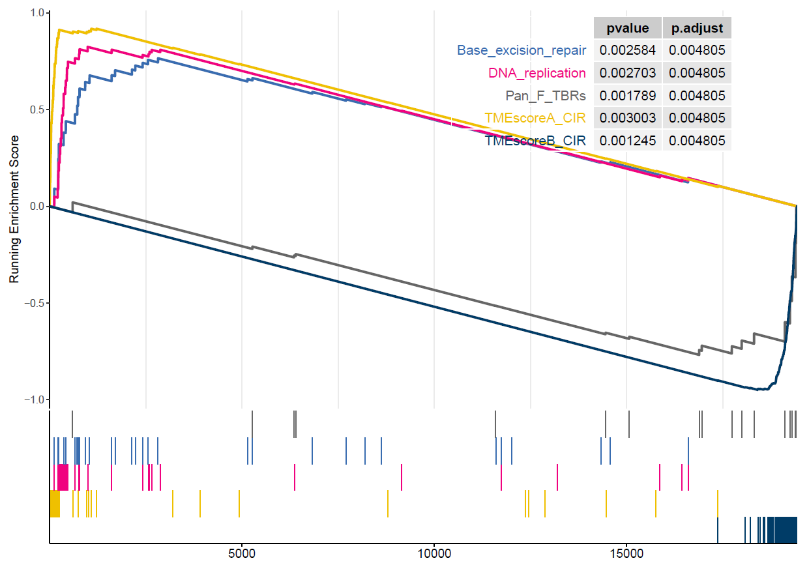
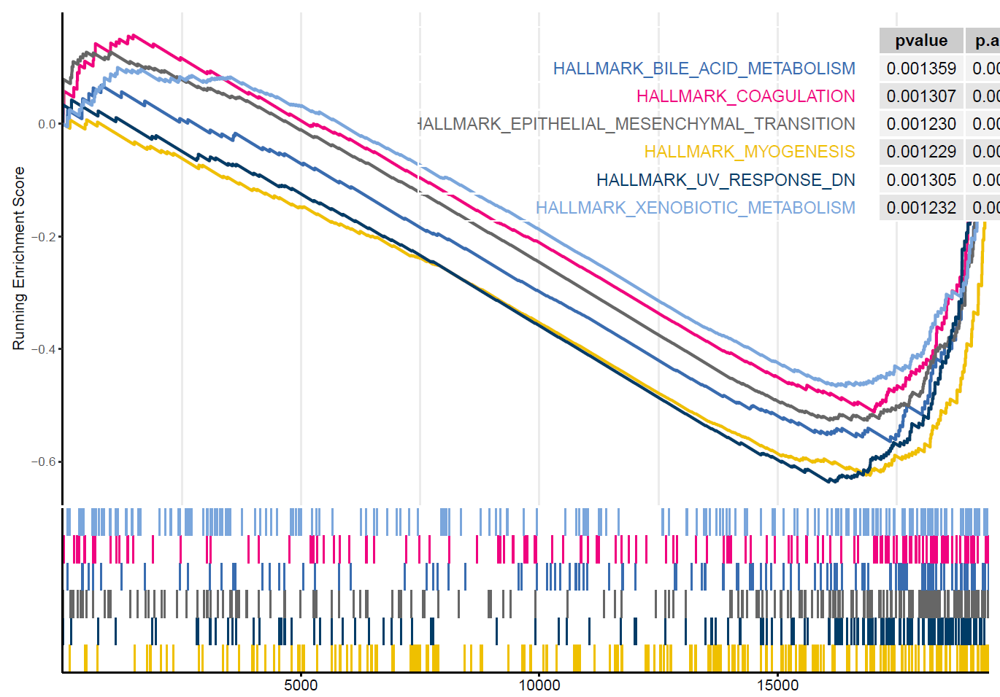
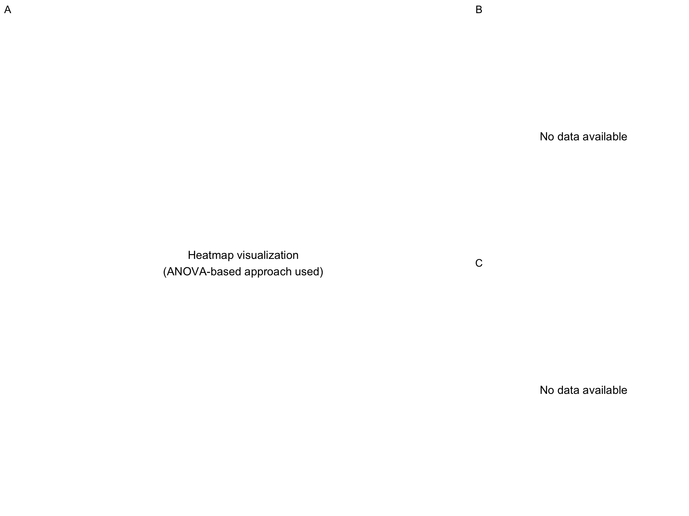
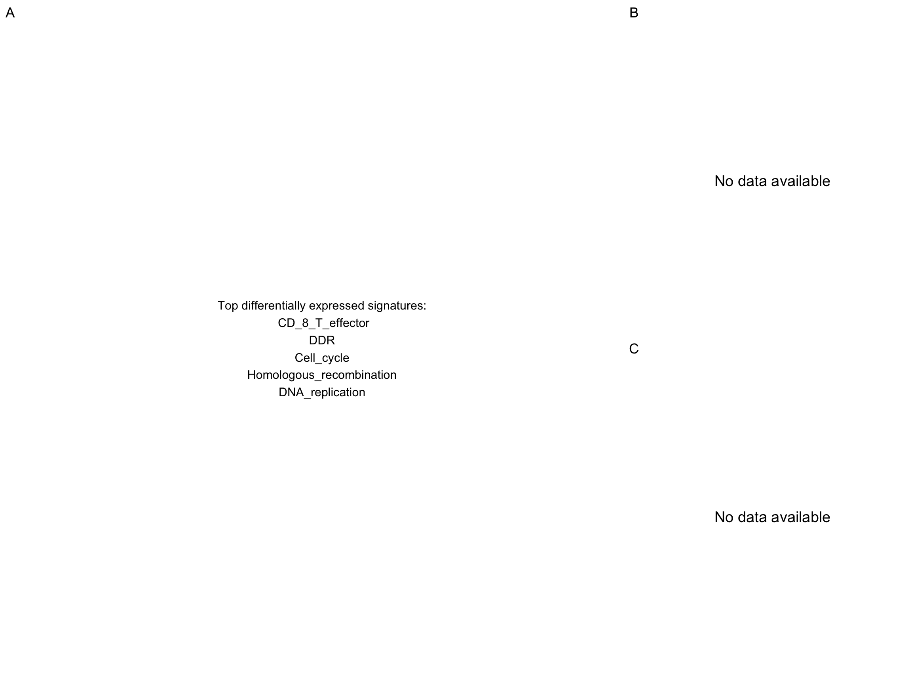
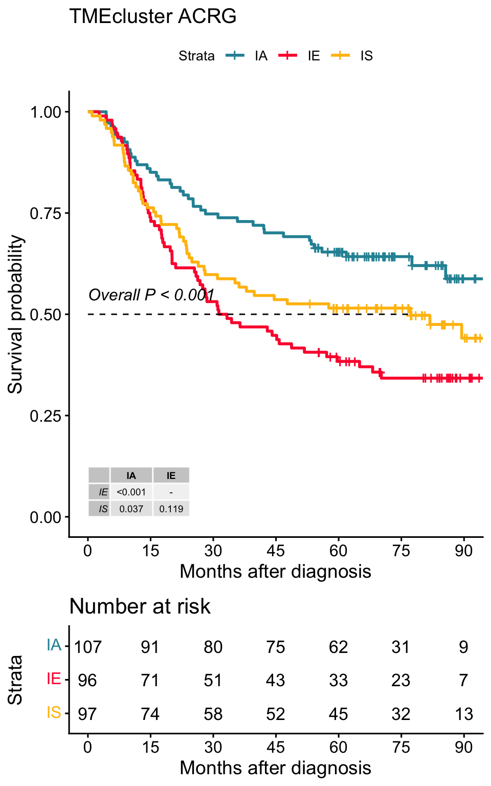
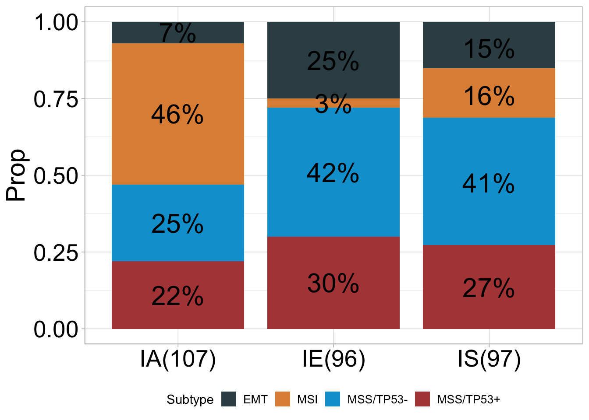
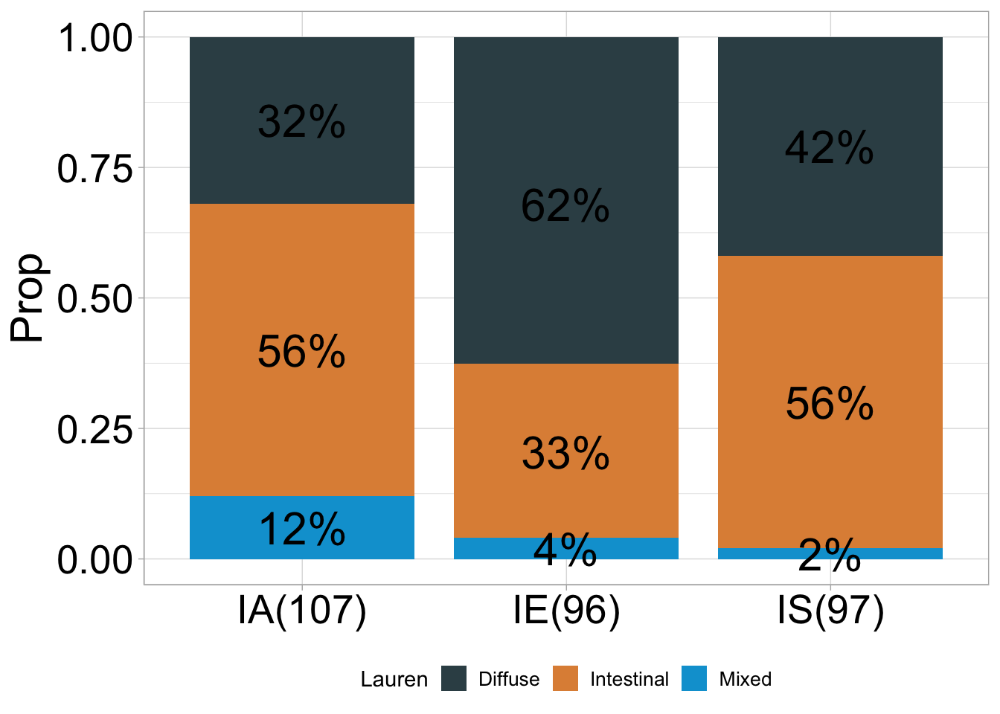
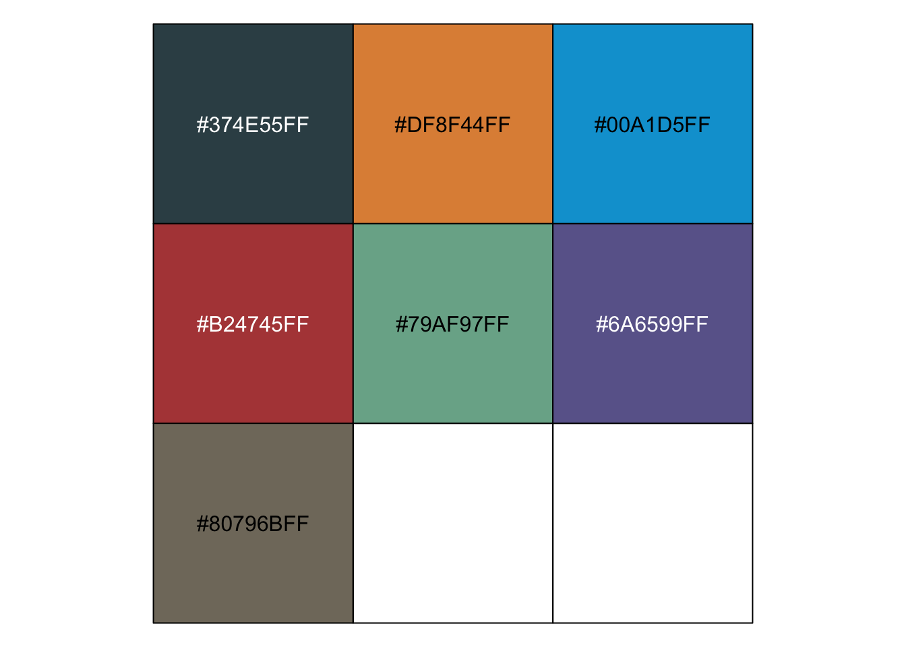
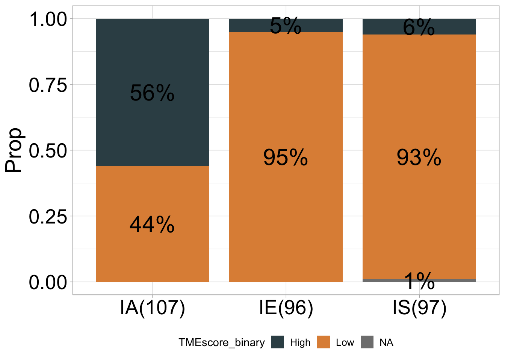
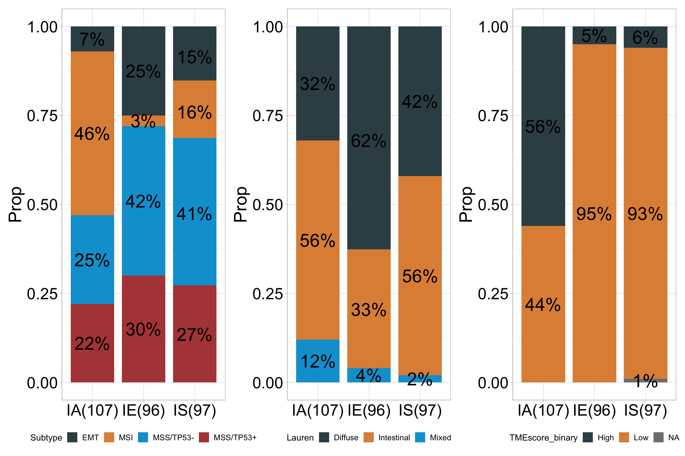

# **Tumor ecosystem analysis**

## Loading packages


``` r
library(IOBR)
library(dplyr)
library(ggplot2)
library(tibble)
```

## Downloading data for example

Obtaining data set from GEO [Gastric cancer: GSE62254](https://pubmed.ncbi.nlm.nih.gov/25894828/) using `GEOquery` R package.


``` r
if (!requireNamespace("GEOquery", quietly = TRUE)) BiocManager::install("GEOquery")
library("GEOquery")
# NOTE: This process may take a few minutes which depends on the internet connection speed. Please wait for its completion.
eset_geo <- tryCatch(
  {
    getGEO(GEO = "GSE62254", getGPL = F, destdir = "./")
  },
  error = function(e) {
    message("Cannot download GSE62254 from GEO: ", e$message)
    message("Using eset_example1 from IOBR package instead...")
    NULL
  }
)

if (is.null(eset_geo)) {
  # Use eset_example1 as fallback - it has samples as rows and genes as columns
  eset <- t(eset_example1)
} else {
  eset <- eset_geo[[1]]
  eset <- exprs(eset)
}
eset[1:5, 1:5]
```

```
##           GSM1523727 GSM1523728 GSM1523729 GSM1523744 GSM1523745
## 1007_s_at  3.2176645  3.0624323  3.0279131   2.921683  2.8456013
## 1053_at    2.4050109  2.4394879  2.2442708   2.345916  2.4328582
## 117_at     1.4933412  1.8067380  1.5959665   1.839822  1.8326058
## 121_at     2.1965561  2.2812181  2.1865556   2.258599  2.1874363
## 1255_g_at  0.8698382  0.9502466  0.8125414   1.012860  0.9441993
```

## Gene Annotation: HGU133PLUS-2 (Affaymetrix)


``` r
# Gene annotation is only needed for GEO data (probe IDs)
# eset_example1 already has gene symbols, so skip annotation when using fallback
if (!is.null(eset_geo)) {
  # Conduct gene annotation using `anno_hug133plus2` file
  anno_hug133plus2 <- load_data("anno_hug133plus2")
  eset <- anno_eset(
    eset = eset,
    annotation = anno_hug133plus2,
    symbol = "symbol",
    probe = "probe_id",
    method = "mean"
  )
}
eset[1:5, 1:3]
```

```
##              GSM1523727 GSM1523728 GSM1523729
## SH3KBP1        4.327974   4.316195   4.351425
## RPL41          4.246149   4.246808   4.257940
## EEF1A1         4.293762   4.291038   4.262199
## COX2           4.250288   4.283714   4.270508
## LOC101928826   4.219303   4.219670   4.213252
```

## Determine TME subtype of gastric cancer using [TMEclassifier R package](https://github.com/LiaoWJLab/TMEclassifier)


``` r
if (!requireNamespace("TMEclassifier", quietly = TRUE)) remotes::install_github("LiaoWJLab/TMEclassifier", dependencies = TRUE)
# Specified version of xgboost
# install.packages("https://cran.r-project.org/src/contrib/Archive/xgboost/xgboost_1.5.2.1.tar.gz", repos = NULL)
library(TMEclassifier)
tme <- tme_classifier(eset = eset, scale = TRUE)
```

```
## Step-1: Expression data preprocessing...
```

```
## Step-2: TME deconvolution...
```

```
## Step-3: Predicting TME phenotypes...
```

```
## >>>--- DONE!
```


``` r
table(tme$TMEcluster)
```

```
## 
##  IA  IE  IS 
## 107  96  97
```

``` r
head(tme)
```

```
##           ID          IE         IS         IA TMEcluster
## 1 GSM1523727 0.204623557 0.11212681 0.68324962         IA
## 2 GSM1523728 0.009599504 0.11179146 0.87860903         IA
## 3 GSM1523729 0.852615046 0.11369089 0.03369407         IE
## 4 GSM1523744 0.053842233 0.06994632 0.87621145         IA
## 5 GSM1523745 0.055973019 0.80839488 0.13563209         IS
## 6 GSM1523746 0.545343299 0.37437568 0.08028102         IE
```

## DEG analysis: method1

Differential analysis of selected immune-activated and immune-expelled gastric cancers


``` r
pdata <- tme[!tme$TMEcluster == "IS", ]
deg <- iobr_deg(
  eset = eset,
  annotation = NULL,
  pdata = pdata,
  group_id = "TMEcluster",
  pdata_id = "ID",
  array = TRUE,
  method = "limma",
  contrast = c("IA", "IE"),
  path = "result",
  padj_cutoff = 0.01,
  logfc_cutoff = 0.5
)
```

```
## ℹ Matching grouping information and expression matrix
```

```
## ℹ Using limma for array differential analysis
```

```
## ℹ Group 1 = IA
```

```
## ℹ Group 2 = IE
```

```
## ✔ DEG results written to: '/Users/wsx/Documents/GitHub/book/result/2-DEGs.csv'
```

## GSEA analysis based on differential express gene analysis results


Select the gene set list in IOBR's signature collection.

``` r
head(deg)
```

```
## # A tibble: 6 × 11
##   symbol  log2FoldChange AveExpr     t   pvalue     padj     B sigORnot    label
##   <chr>            <dbl>   <dbl> <dbl>    <dbl>    <dbl> <dbl> <chr>       <chr>
## 1 TMEM100         -0.774    1.84 -13.9 2.47e-31 5.37e-27  60.4 Down_regul… Both 
## 2 ABCA8           -0.933    1.90 -12.9 3.11e-28 3.38e-24  53.4 Down_regul… Both 
## 3 HHIP            -0.613    1.73 -12.1 7.62e-26 4.46e-22  48.0 Down_regul… Both 
## 4 LMNB2            0.287    2.25  12.1 9.28e-26 4.46e-22  47.8 NOT         Sign…
## 5 MCM6             0.211    3.02  12.1 1.02e-25 4.46e-22  47.7 NOT         Sign…
## 6 ADH1B           -0.907    1.86 -12.0 2.27e-25 7.04e-22  47.0 Down_regul… Both 
## # ℹ 2 more variables: IA <dbl>, IE <dbl>
```

``` r
signature_collection <- load_data("signature_collection")
sig_list <- signature_collection[c(
  "TMEscoreB_CIR", "TMEscoreA_CIR", "DNA_replication", "Base_excision_repair",
  "Pan_F_TBRs", "TGFb.myCAF", "Ferroptosis", "TLS_Nature", "Glycolysis"
)]
```


``` r
gsea <- sig_gsea(deg,
  genesets          = sig_list,
  path              = "result",
  gene_symbol       = "symbol",
  logfc             = "log2FoldChange",
  org               = "hsa",
  show_plot         = FALSE,
  msigdb            = TRUE,
  category          = "H",
  subcategory       = NULL,
  palette_bar       = "set2"
)
```

<div class="figure" style="text-align: center">

<p class="caption">(\#fig:unnamed-chunk-9)GSEA of TME gent sets</p>
</div>

Hallmark gene signatures

``` r
gsea <- sig_gsea(deg,
  genesets          = NULL,
  path              = "GSEA",
  gene_symbol       = "symbol",
  logfc             = "log2FoldChange",
  org               = "hsa",
  show_plot         = FALSE,
  msigdb            = TRUE,
  category          = "H",
  subcategory       = NULL,
  palette_bar       = "aaas",
  show_bar          = 5,
  show_gsea         = 6
)
```

<div class="figure" style="text-align: center">

<p class="caption">(\#fig:unnamed-chunk-11)GSEA of Hallmark gent sets</p>
</div>


## DEG analysis: method2

Identifing TME subtype-related differential genes using alternative approach (ANOVA-based)

``` r
library(Seurat)
res <- find_markers_in_bulk(
  pdata = tme,
  eset = eset,
  group = "TMEcluster",
  nfeatures = 2000,
  top_n = 50,
  thresh.use = 0.15,
  only.pos = TRUE,
  min.pct = 0.10
)
top15 <- res$top_markers %>%
  dplyr::group_by(cluster) %>%
  dplyr::top_n(15, avg_log2FC)
top15$gene
```

```
##  [1] "IDO1"           "CXCL11"         "SLCO1B3"        "IFNG"          
##  [5] "AIM2"           "GZMB"           "VSNL1"          "CXCL10"        
##  [9] "CXCL9"          "GBP4"           "KLRC2"          "GNLY"          
## [13] "GZMH"           "KISS1R"         "WARS"           "C2orf40"       
## [17] "OGN"            "PGA4"           "SCN7A"          "C7"            
## [21] "ADH1B"          "GIF"            "SCRG1"          "LIPF"          
## [25] "GHRL"           "MAMDC2"         "VIP"            "ABCA8"         
## [29] "ATP4A"          "TMEM100"        "REG1B"          "MAGEA12"       
## [33] "MAGEA4"         "IL1A"           "PI15"           "IL11"          
## [37] "MAGEA6"         "MAGEA10-MAGEA5" "PPBP"           "PROK2"         
## [41] "MAGEA2B"        "CLEC5A"         "IL24"           "CTAG1A"        
## [45] "EREG"
```

Heatmap visualisation using `Seurat`'s `DoHeatmap`

``` r
# 定义分型对应的颜色
cols <- c("#2692a4", "#fc0d3a", "#ffbe0b")
p1 <- DoHeatmap(res$sce, top15$gene, group.colors = cols) +
  scale_fill_gradientn(colours = rev(colorRampPalette(RColorBrewer::brewer.pal(11, "RdBu"))(256)))
```

Extracting variables from the expression matrix to merge with TME subtypes


``` r
input <- combine_pd_eset(eset = eset, pdata = tme, feas = top15$gene, scale = T)
p2 <- sig_box(input,
  variable = "TMEcluster", signature = "IFNG", jitter = TRUE,
  cols = cols, size_of_pvalue = 4
)
```

```
## Warning: The `size` argument of `element_line()` is deprecated as of ggplot2 3.4.0.
## ℹ Please use the `linewidth` argument instead.
## ℹ The deprecated feature was likely used in the IOBR package.
##   Please report the issue at <https://github.com/IOBR/IOBR/issues>.
## This warning is displayed once per session.
## Call `lifecycle::last_lifecycle_warnings()` to see where this warning was
## generated.
```

```
## # A tibble: 3 × 8
##   .y.       group1 group2        p    p.adj p.format p.signif method  
##   <chr>     <chr>  <chr>     <dbl>    <dbl> <chr>    <chr>    <chr>   
## 1 signature IA     IE     4.09e-17 1.20e-16 < 2e-16  ****     Wilcoxon
## 2 signature IA     IS     1.44e-13 2.90e-13 1.4e-13  ****     Wilcoxon
## 3 signature IE     IS     8.35e- 2 8.4 e- 2 0.084    ns       Wilcoxon
```

``` r
p3 <- sig_box(input,
  variable = "TMEcluster", signature = "IL1A",
  jitter = TRUE, cols = cols, size_of_pvalue = 4
)
```

```
## # A tibble: 3 × 8
##   .y.       group1 group2        p    p.adj p.format p.signif method  
##   <chr>     <chr>  <chr>     <dbl>    <dbl> <chr>    <chr>    <chr>   
## 1 signature IA     IE     1.46e-10 2.90e-10 1.5e-10  ****     Wilcoxon
## 2 signature IA     IS     8.22e- 7 8.2 e- 7 8.2e-07  ****     Wilcoxon
## 3 signature IE     IS     4.90e-20 1.5 e-19 < 2e-16  ****     Wilcoxon
```


``` r
if (!requireNamespace("patchwork", quietly = TRUE)) install.packages("patchwork")
library(patchwork)
p <- (p1 | p2 / p3) + plot_layout(widths = c(2.3, 1))
p + plot_annotation(tag_levels = "A")
```




## Identifying signatures associated with TME clusters

Calculate TME associated signatures-(through PCA method).

``` r
sig_tme <- calculate_sig_score(
  pdata = NULL,
  eset = eset,
  signature = signature_collection,
  method = "pca",
  mini_gene_count = 2
)
sig_tme <- t(column_to_rownames(sig_tme, var = "ID"))
sig_tme[1:5, 1:3]
```

```
##                   GSM1523727 GSM1523728 GSM1523729
## CD_8_T_effector   -2.5513794  0.7789141 -2.1770675
## DDR               -0.8747614  0.7425162 -1.3272054
## APM                1.1098368  2.1988688 -0.9516419
## Immune_Checkpoint -2.3701787  0.9455120 -1.4844104
## CellCycle_Reg      0.1063358  0.7583302 -0.3649795
```

Finding signatures or cell types associated with TMEcluster

``` r
res <- find_markers_in_bulk(pdata = tme, eset = sig_tme, group = "TMEcluster", nfeatures = 1000, top_n = 20, min.pct = 0.10)

top15 <- res$top_markers %>%
  dplyr::group_by(cluster) %>%
  dplyr::top_n(15, avg_log2FC)

p1 <- DoHeatmap(res$sce, top15$gene, group.colors = cols) +
  scale_fill_gradientn(colours = rev(colorRampPalette(RColorBrewer::brewer.pal(11, "RdBu"))(256)))
```


``` r
top15$gene <- gsub(top15$gene, pattern = "-", replacement = "\\_")
input <- combine_pd_eset(eset = sig_tme, pdata = tme, feas = top15$gene, scale = T)

p2 <- sig_box(input,
  variable = "TMEcluster", signature = "CD_8_T_effector", jitter = TRUE,
  cols = cols, size_of_pvalue = 4, size_of_font = 6
)
```

```
## # A tibble: 3 × 8
##   .y.       group1 group2        p    p.adj p.format p.signif method  
##   <chr>     <chr>  <chr>     <dbl>    <dbl> <chr>    <chr>    <chr>   
## 1 signature IA     IE     3.53e-10 7.10e-10 3.5e-10  ****     Wilcoxon
## 2 signature IA     IS     8.49e-13 2.5 e-12 8.5e-13  ****     Wilcoxon
## 3 signature IE     IS     1.41e- 1 1.4 e- 1 0.14     ns       Wilcoxon
```

``` r
p3 <- sig_box(input,
  variable = "TMEcluster", signature = "Neutrophils_Bindea_et_al",
  jitter = TRUE, cols = cols, size_of_pvalue = 4, size_of_font = 6
)
```

```
## # A tibble: 3 × 8
##   .y.       group1 group2         p   p.adj p.format p.signif method  
##   <chr>     <chr>  <chr>      <dbl>   <dbl> <chr>    <chr>    <chr>   
## 1 signature IA     IE     0.00639   0.013   0.0064   **       Wilcoxon
## 2 signature IA     IS     0.0584    0.058   0.0584   ns       Wilcoxon
## 3 signature IE     IS     0.0000929 0.00028 9.3e-05  ****     Wilcoxon
```


``` r
p <- (p1 | p2 / p3) + plot_layout(widths = c(2.3, 1))
p + plot_annotation(tag_levels = "A")
```




``` r
library(survminer)
```

```
## Loading required package: ggpubr
```

``` r
pdata_acrg <- load_data("pdata_acrg")
input <- merge(pdata_acrg, input, by = "ID")
p1 <- surv_group(
  input_pdata = input,
  target_group = "TMEcluster",
  ID = "ID",
  reference_group = "High",
  project = "ACRG",
  cols = cols,
  time = "OS_time",
  status = "OS_status",
  time_type = "month",
  save_path = "result"
)
```

```
## ℹ Follow-up time ranges from 1 to 105.7 months
```

```
##  IA  IE  IS 
## 107  96  97
```

```
## ℹ Maximum follow-up time is 105.7 months; divided into 6 sections
```

```
## Registered S3 methods overwritten by 'ggpp':
##   method                  from   
##   heightDetails.titleGrob ggplot2
##   widthDetails.titleGrob  ggplot2
```

```
## Ignoring unknown labels:
## • colour : "Strata"
```

``` r
p1
```




``` r
p1 <- percent_bar_plot(input, x = "TMEcluster", y = "Subtype", palette = "jama")
```

```
## # A tibble: 12 × 5
## # Groups:   TMEcluster [3]
##    TMEcluster Subtype    Freq  Prop count
##    <chr>      <fct>     <dbl> <dbl> <dbl>
##  1 IA         EMT           7  0.07   107
##  2 IA         MSI          49  0.46   107
##  3 IA         MSS/TP53-    27  0.25   107
##  4 IA         MSS/TP53+    24  0.22   107
##  5 IE         EMT          24  0.25    96
##  6 IE         MSI           3  0.03    96
##  7 IE         MSS/TP53-    40  0.42    96
##  8 IE         MSS/TP53+    29  0.3     96
##  9 IS         EMT          15  0.15    97
## 10 IS         MSI          16  0.16    97
## 11 IS         MSS/TP53-    40  0.41    97
## 12 IS         MSS/TP53+    26  0.27    97
```

```
## ℹ Available categories: box, continue2, continue, random, heatmap, heatmap3, tidyheatmap
```

```
## ℹ Box palettes: nrc, jama, aaas, jco, paired1, paired2, paired3, paired4, accent, set2
```

```
## [1] "'#374E55FF', '#DF8F44FF', '#00A1D5FF', '#B24745FF', '#79AF97FF', '#6A6599FF', '#80796BFF'"
```



``` r
p2 <- percent_bar_plot(input, x = "TMEcluster", y = "Lauren", palette = "jama")
```

```
## # A tibble: 9 × 5
## # Groups:   TMEcluster [3]
##   TMEcluster Lauren      Freq  Prop count
##   <chr>      <fct>      <dbl> <dbl> <dbl>
## 1 IA         Diffuse       34  0.32   107
## 2 IA         Intestinal    60  0.56   107
## 3 IA         Mixed         13  0.12   107
## 4 IE         Diffuse       60  0.62    96
## 5 IE         Intestinal    32  0.33    96
## 6 IE         Mixed          4  0.04    96
## 7 IS         Diffuse       41  0.42    97
## 8 IS         Intestinal    54  0.56    97
## 9 IS         Mixed          2  0.02    97
```

```
## ℹ Available categories: box, continue2, continue, random, heatmap, heatmap3, tidyheatmap
## ℹ Box palettes: nrc, jama, aaas, jco, paired1, paired2, paired3, paired4, accent, set2
```

```
## [1] "'#374E55FF', '#DF8F44FF', '#00A1D5FF', '#B24745FF', '#79AF97FF', '#6A6599FF', '#80796BFF'"
```



``` r
p3 <- percent_bar_plot(input, x = "TMEcluster", y = "TMEscore_binary", palette = "jama")
```

```
## # A tibble: 7 × 5
## # Groups:   TMEcluster [3]
##   TMEcluster TMEscore_binary  Freq  Prop count
##   <chr>      <fct>           <dbl> <dbl> <dbl>
## 1 IA         High               60  0.56   107
## 2 IA         Low                47  0.44   107
## 3 IE         High                5  0.05    96
## 4 IE         Low                91  0.95    96
## 5 IS         High                6  0.06    97
## 6 IS         Low                90  0.93    97
## 7 IS         <NA>                1  0.01    97
```

```
## ℹ Available categories: box, continue2, continue, random, heatmap, heatmap3, tidyheatmap
## ℹ Box palettes: nrc, jama, aaas, jco, paired1, paired2, paired3, paired4, accent, set2
```

```
## [1] "'#374E55FF', '#DF8F44FF', '#00A1D5FF', '#B24745FF', '#79AF97FF', '#6A6599FF', '#80796BFF'"
```




``` r
p1 | p2 | p3
```



## References

Cristescu, R., Lee, J., Nebozhyn, M. et al. Molecular analysis of gastric cancer identifies subtypes associated with distinct clinical outcomes. Nat Med 21, 449–456 (2015). https://doi.org/10.1038/nm.3850

[CIBERSORT](https://cibersort.stanford.edu/); Newman, A. M., Liu, C. L., Green, M. R., Gentles, A. J., Feng, W., Xu, Y., … Alizadeh, A. A. (2015). Robust enumeration of cell subsets from tissue expression profiles. Nature Methods, 12(5), 453–457.  https://doi.org/10.1038/nmeth.3337; 

Seurat: Hao and Hao et al. Integrated analysis of multimodal single-cell data. Cell (2021)

Zeng D, Yu Y, Qiu W, Mao Q, …, Zhang K, Liao W; Tumor microenvironment immunotyping heterogeneity reveals distinct molecular mechanisms to clinical immunotherapy applications in gastric cancer. (2024) Under Review.
