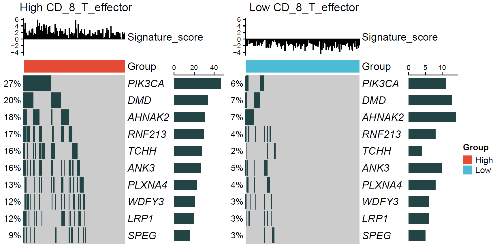
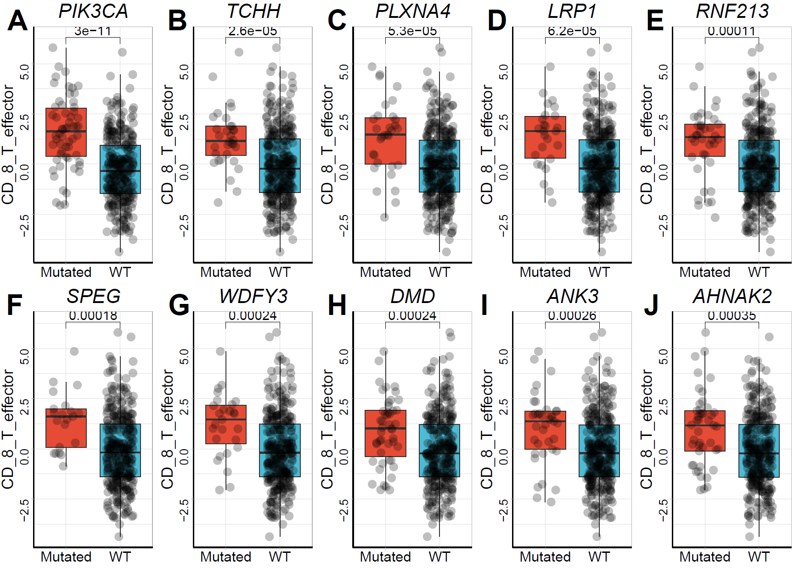

# **TME and genomic interaction**

## Loading packages


``` r
library(IOBR)
```

## Genomic data prepare

In this section, we are going to use the MAF data of TCGA-STAD cohort as an example dataset. This dataset could be found in multiple places, here we show two ways to get it.

### Using TCGAbiolinks to download genomic data
R Bioconductor package **[TCGAbiolinks](https://bioconductor.org/packages/TCGAbiolinks/)** provides an R interface of [GDC data portal](https://portal.gdc.cancer.gov/), which stores updating TCGA data. You can check and install this package with the following code.


``` r
if (!requireNamespace("TCGAbiolinks", quietly = TRUE)) {
  BiocManager::install("TCGAbiolinks")
}
```

Then you can query, download and prepare the required dataset.


``` r
library(TCGAbiolinks)
query <- GDCquery(
  project = "TCGA-STAD",
  data.category = "Simple Nucleotide Variation",
  access = "open",
  data.type = "Masked Somatic Mutation",
  workflow.type = "Aliquot Ensemble Somatic Variant Merging and Masking"
)
GDCdownload(query)
maf <- GDCprepare(query)
```
This `maf` object is a `data.frame`, you can use `read.maf()` from R package **[Maftools](https://github.com/PoisonAlien/maftools)** to convert it to a MAF object.

In this example, we used the maf file of TCGA-STAD to extract the SNPs in it,and then transformed it into a non-negative matrix.

``` r
(load("TCGA-STAD.maf.RData"))
```

```
## [1] "maf"
```

``` r
mut_list <- make_mut_matrix(maf = maf, isTCGA = T, category = "multi")
```

```
## -Validating
## -Silent variants: 45460 
## -Summarizing
## --Possible FLAGS among top ten genes:
##   TTN
##   MUC16
##   SYNE1
##   FLG
## -Processing clinical data
## --Missing clinical data
## -Finished in 3.097s elapsed (3.213s cpu)
```

```
##        Frame_Shift_Del        Frame_Shift_Ins           In_Frame_Del 
##                  21547                   4526                   1196 
##           In_Frame_Ins      Missense_Mutation      Nonsense_Mutation 
##                    106                 102137                   5669 
##       Nonstop_Mutation            Splice_Site Translation_Start_Site 
##                    117                   2242                    107
```

```
##    DEL    INS    ONP    SNP 
##  22997   4675     10 109965
```

``` r
mut <- mut_list$snp
```

## Identifying Mutations Associated with TME
The microenvironmental data from the TCGA-STAD expression matrix was merged. The Cuzick or Wilcoxon test was used to identify genetic variants associated with microenvironmental factors. CD_8_T_effector was used as the target variable in this example.

``` r
tcga_stad_sig <- load_data("tcga_stad_sig")
res <- tryCatch(
  {
    find_mutations(
      mutation_matrix = mut,
      signature_matrix = tcga_stad_sig,
      id_signature_matrix = "ID",
      signature = "CD_8_T_effector",
      palette = "nrc",
      min_mut_freq = 0.01,
      plot = TRUE,
      jitter = TRUE
    )
  },
  error = function(e) {
    message("find_mutations error: ", e$message)
    NULL
  }
)
```

```
## Warning: The `size` argument of `element_line()` is deprecated as of ggplot2 3.4.0.
## ℹ Please use the `linewidth` argument instead.
## ℹ The deprecated feature was likely used in the IOBR package.
##   Please report the issue at <https://github.com/IOBR/IOBR/issues>.
## This warning is displayed once per session.
## Call `lifecycle::last_lifecycle_warnings()` to see where this warning was
## generated.
```

```
## [1] ">>>> Result of Cuzick Test"
##             p.value  names statistic adjust_pvalue
## PIK3CA 6.279087e-10 PIK3CA  6.183261  3.139543e-07
## PLXNA4 8.196539e-05 PLXNA4  3.938580  2.049135e-02
## DMD    3.514677e-04    DMD  3.574075  3.882570e-02
## SPEG   3.665757e-04   SPEG  3.563047  3.882570e-02
## AHNAK2 3.882570e-04 AHNAK2  3.547940  3.882570e-02
## TCHH   6.571311e-04   TCHH  3.406867  5.476093e-02
## ABCC9  1.043516e-03  ABCC9  3.278524  7.453684e-02
## ANK3   1.470480e-03   ANK3  3.180447  7.713409e-02
## WDFY3  1.690248e-03  WDFY3  3.139867  7.713409e-02
## LRP1   1.762002e-03   LRP1  3.127666  7.713409e-02
```

```
## find_mutations error: object 'file_name' not found
```

## OncoPrint of result
<div class="figure" style="text-align: center">

<p class="caption">(\#fig:unnamed-chunk-6)OncoPrint</p>
</div>

## Boxplot of top 10 mutated genes
<div class="figure" style="text-align: center">

<p class="caption">(\#fig:unnamed-chunk-7)Top 10 mutated genes</p>
</div>

## Other methods to obtaind genomic data

### Using TCGAmutations

As its name, the R package **[TCGAmutations](https://github.com/PoisonAlien/TCGAmutations)** provides pre-compiled, curated somatic mutations from 33 TCGA cohorts along with relevant clinical information for all sequenced samples. You can install it similar to the **TCGAbiolinks**.


``` r
if (!requireNamespace("TCGAmutations", quietly = TRUE)) {
  BiocManager::install("PoisonAlien/TCGAmutations")
}
```

It's quite simple to use:


``` r
maf <- TCGAmutations::tcga_load(study = "STAD")
# Change `source` argument to Firehose for MAF files from Broad Firehose
# maf = TCGAmutations::tcga_load(study = "STAD", source = "Firehose")
```

### Using maftools
If you are a user of R package **[Maftools](https://github.com/PoisonAlien/maftools)**, you can access and load the data in a similar way (because the author of **TCGAmutations** and **Maftools** is the same person).


``` r
# The following github can be changed to gitee
# it maybe fast in China mainland
maftools::tcgaAvailable(repo = "github")
maftools::tcgaLoad("STAD", repo = "github")
```

MAF data transformation
To prepare the data for the downstream analysis. We need to extract the SNV data in it and transform it into a non-negative matrix.


``` r
mut_list <- make_mut_matrix(maf = maf, isTCGA = TRUE, category = "multi")
```

## References

Wang et al., (2019). The UCSCXenaTools R package: a toolkit for accessing genomics data from UCSC Xena platform, from cancer multi-omics to single-cell RNA-seq. Journal of Open Source Software, 4(40), 1627, https://doi.org/10.21105/joss.01627

Gu, Z. (2022) Complex Heatmap Visualization. iMeta.

Anand Mayakonda et al., (2018) Maftools: efficient and comprehensive analysis of somatic variants in cancer. Genome Research


